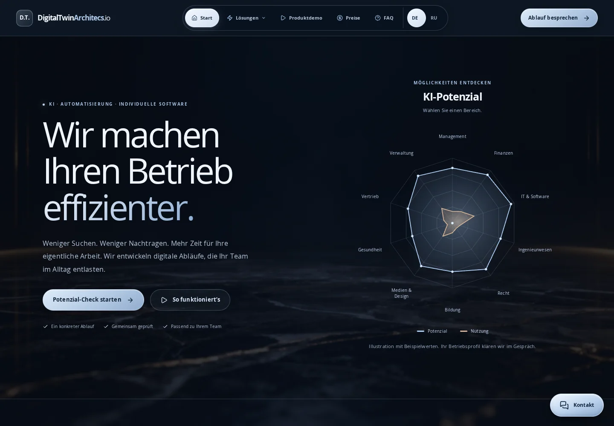
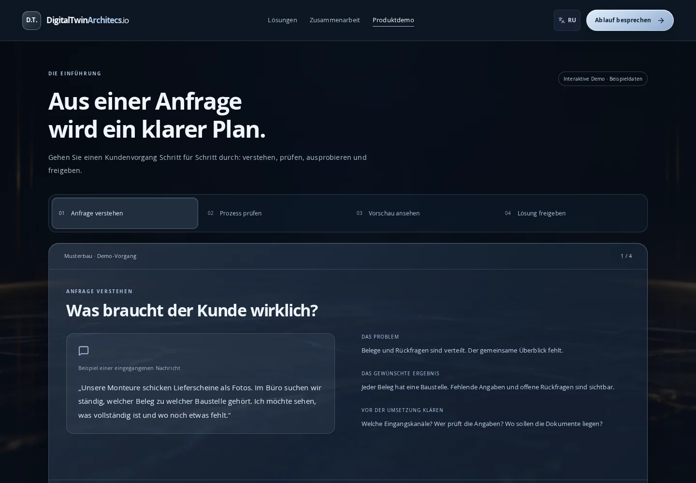
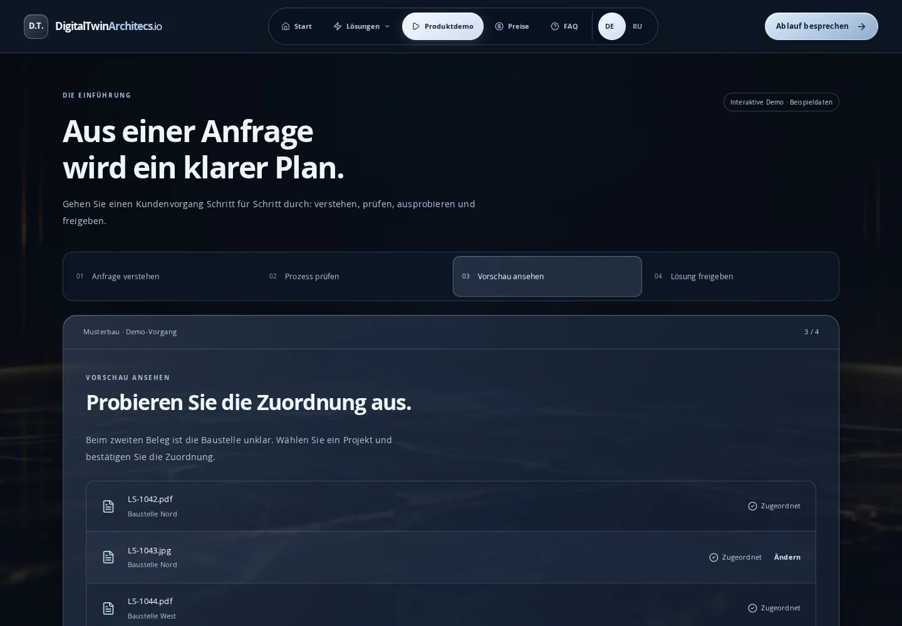
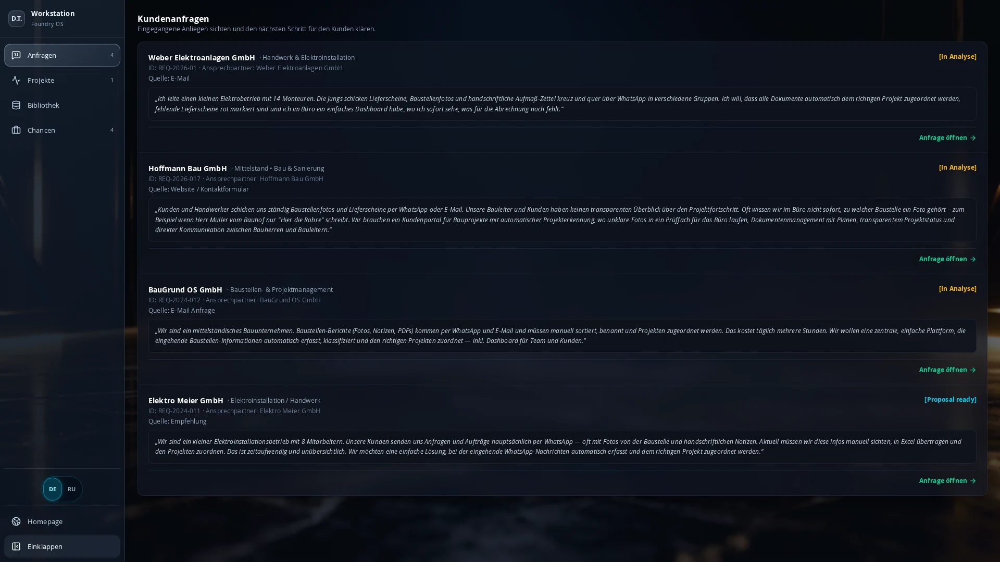
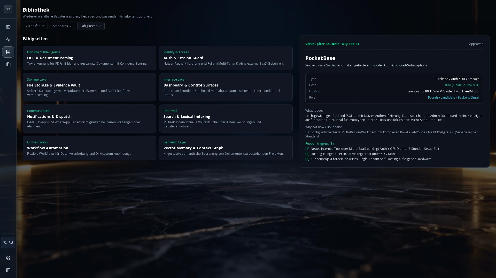
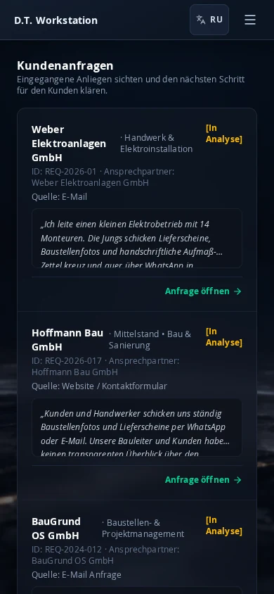
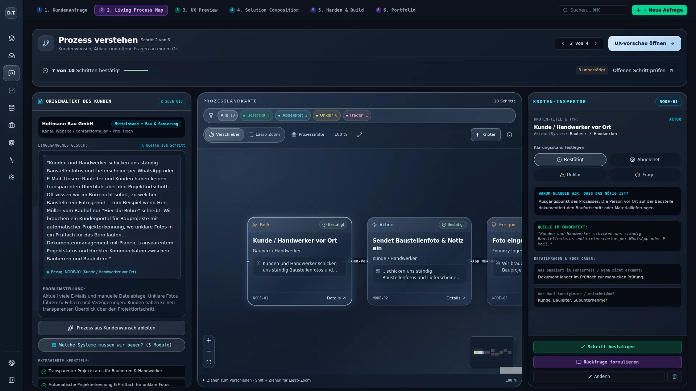
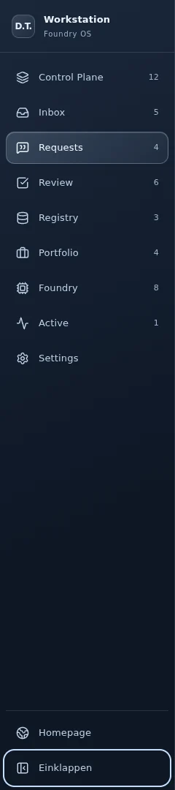
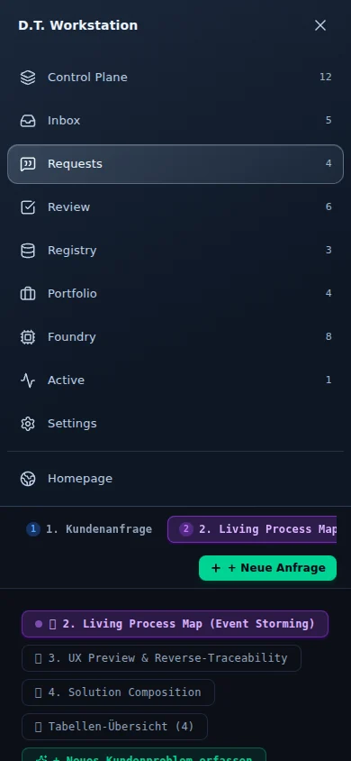

# Kompakte Workstation-Navigation

## Öffentliche Website und Einführung – 21.10.2026

Dieser Folgeschritt baut auf der Kunden-Navigation aus PR #5 (`9b516299d3029a35fc4147e01b032421adb8c8e3`) auf. Die Workstation behält ihre vier Arbeitsbereiche. Website, Einführung und Arbeitsbereich haben nun unterschiedliche Aufgaben:

| Zugang | Aufgabe |
| --- | --- |
| `#/` | Öffentlicher Einstieg für Interessenten: Nutzen, Leistungen, Branchenbeispiele, Preise, FAQ und Potenzial-Check. |
| `#/demo` | Geführte Produktdemo mit eigenen Beispieldaten. |
| `#/workstation` | Vorhandene Workstation mit Anfragen, Projekten, Bibliothek und Chancen. |

Hash-Adressen halten Direktlinks, Neuladen und Browser-Zurück auch bei statischem Hosting ohne zusätzliche Server-Routingregeln nutzbar. Die bisherige Standardansicht der Workstation wird dadurch zur öffentlichen Website. Ein Operator kann die Workstation direkt als Lesezeichen öffnen. Die Workstation und ihre Beispieldaten werden erst beim ersten Aufruf dieses Zugangs geladen. Nach dem Öffnen bleibt ihr React-Zustand beim Besuch der Einführung erhalten, einschließlich gewähltem Kunden, Objekten und Navigation.

### Ergänzung: prägende Elemente der alten Website

Nach dem ersten Entwurf wurde ausdrücklich bestätigt, das Spinnendiagramm sowie die vier gezeigten Elemente der alten Website wiederzuverwenden. Im Einstieg ersetzt deshalb ein interaktives Zehn-Achsen-Diagramm wieder die Beleg-Vorschau; der konkrete Belegablauf bleibt in der Produktdemo. Das Diagramm wird direkt als SVG mit HTML-Bedienelementen gerendert und benötigt keine zusätzliche Chart-Bibliothek. Alle Kategorien lassen sich mit Maus, Touch und Tastatur öffnen. Der Detailbereich zeigt Erklärung und Beispielwerte; Escape und Schließen geben den Fokus an den Auslöser zurück.

Die fest hinterlegten Potenzial-/Nutzungswerte der früheren Demo bleiben **ausdrücklich illustrative Beispielwerte**. Die Quellenprüfung vom 21.10.2026 ergab: Die [verlinkte Anthropic-Studie vom 05.03.2026](https://www.anthropic.com/research/labor-market-impacts) nennt für Computer/Mathematik beispielsweise 94 % theoretische und 33 % beobachtete Aufgabenabdeckung, während die frühere UI 95/35 für „IT & Software“ zeigte. Auch die Kategorien und die Bedeutung der Messung sind nicht identisch. Die Studie misst kein individuelles Kundenprofil. Die Beispielkurven werden deshalb nicht als Studienwerte ausgegeben und nicht mit einer entsprechenden Datenquellenbehauptung versehen.

Die Desktop-Navigation verwendet wieder eine Glaskapsel mit Symbolen und heller aktiver Auswahl. Die Sprachwahl sitzt darin. Unter **„Lösungen“** sind KI-Beratung, Automatisierung, Chatbots/Wissenszugang und Zusammenarbeit erreichbar. „Preise“ und „FAQ“ führen zu tatsächlichen Abschnitten; die jeweiligen Adressen funktionieren auch direkt und nach Neuladen. Auf kleineren Bildschirmen wird die Navigation aufgeklappt. Untermenü und Hauptmenü schließen mit Escape beziehungsweise nach einer Auswahl. Die Ziele werden unterhalb des festen Headers sichtbar und erhalten Tastaturfokus.

Der Kontaktblock enthält E-Mail, anklickbare Telefonnummer und Bregenz als Standort. `src/data/publicContact.ts` ist die gemeinsame Quelle für die Kontaktdaten, die E-Mail-Übergabe und die schwebenden Aktionen. Die abweichende persönliche E-Mail-Adresse aus dem alten `SideChatTrigger.tsx` wird nicht übernommen. Ein einzelner plastischer Kontaktbutton öffnet WhatsApp, Anrufen und E-Mail. Die Leiste lässt sich auch durch Escape oder einen Klick außerhalb schließen. Sie erscheint auf der öffentlichen Website; die Einführung und Workstation behalten ihre eigenen Bedienelemente. Die Links wurden technisch geprüft, ohne einen Anruf, eine Nachricht oder eine E-Mail auszulösen.

Im Footer ist GitHub mit dem vorhandenen Repository-Owner verlinkt. Für LinkedIn, Instagram, TikTok und YouTube waren in den geprüften Repos keine Profiladressen vorhanden; die alten Symbole zeigten nur auf `#`. Die Icon-Zuordnung ist vorbereitet, unkonfigurierte Profile werden jedoch nicht als Links ausgegeben. Weitere verifizierte Profile werden in derselben Kontaktkonfiguration ergänzt.

Der Preisabschnitt erklärt Angebot, Leistungsumfang und getrennte Umsetzungs-/Betriebskosten. Die alten Paketbeträge hatten keinen eindeutig angegebenen Abrechnungszeitraum; sie werden nicht als bestätigte Preise übernommen. Die FAQ beantwortet konkrete Einstiegsfragen und verwendet native, per Tastatur bedienbare Aufklappfelder. Pauschale Datenschutz-, Lieferzeit- und Integrationsgarantien wurden nicht aus der alten Fassung kopiert.

### Übernahme aus der älteren Website

Grundlage ist [Berufsgruppen-DigitalTwinArchitecs.io](https://github.com/TheNextthing1994/Berufsgruppen-DigitalTwinArchitecs.io/tree/653706a05f92420681043fc160eea6314f6cf025), Stand `653706a05f92420681043fc160eea6314f6cf025`. Ausgewertet wurden insbesondere `Home.tsx`, `Hero.tsx`, `PotentialQuiz.tsx`, `Footer.tsx` und die deutschen/russischen Inhalte in `translations.ts`.

Übernommen und für diese Anwendung neu zusammengesetzt sind die Marke **DigitalTwinArchitecs.io**, der Einstieg „Wir machen Ihren Betrieb …“, der Potenzial-Check, die Erklärung des Digitalen Zwillings und ausgewählte Branchenbeispiele. Die ältere Website bleibt im Quell-Repo unverändert. Dies ist eine kuratierte Übernahme der Kundenansprache, kein unveränderter Import aller bisherigen Unterseiten und Abhängigkeiten.

Handwerk, Dienstleistung und Onlinehandel zeigen jeweils das heutige Problem, einen möglichen Zielablauf und einen passenden Kontakt-Einstieg. Es sind ausdrücklich Beispiele möglicher Lösungen. Der gewählte Anwendungsfall wird in den Anfrageentwurf übernommen. Der visuelle Rahmen verwendet den vorhandenen Hintergrund und Slate-/Steel-Blue-Glasflächen. Die Glasflächen sind auf `.dt-public` begrenzt, damit globale Prozess-Styles ihre Füllung nicht überschreiben.

Die früheren pauschalen ROI-, Fehlerfreiheits-, Lieferzeit- und Compliance-Versprechen sowie nicht belegte Referenzergebnisse werden in dieser Fassung nicht angezeigt. Der öffentliche Einstieg erläutert den überprüfbaren Ablauf der Zusammenarbeit: verstehen, Vorschau prüfen, Umfang und Kosten vereinbaren. Der defekte Startseiten-Verweis auf `#case-studies` wird durch die tatsächliche Produktdemo ersetzt. Beratung, Automatisierung, Chatbots, Preise und FAQ sind als angepasste Abschnitte erreichbar. Weitere Branchen und der Gemini-Chat werden nicht als bereits eingerichtete Leistungen oder Integrationen übernommen.

### Potenzial-Check und Übergabe

Der Check fragt nach Ziel, Teamgröße und zeitlichem Bedarf. Die Auswahl erfolgt bewusst mit „Weiter“, bleibt beim Zurückgehen erhalten und kann geändert werden. Kontaktfelder sind beschriftet und validiert. Telefonnummer und Budget sind keine Pflicht zum Einstieg. Die Antworten werden während des Checks nur im Seitenzustand gehalten.

„Anfrage vorbereiten“ erzeugt einen prüfbaren Text mit den Antworten, dem ausgewählten Branchenbeispiel und dem konkreten Anliegen. Anschließend öffnet ein `mailto:`-Link einen E-Mail-Entwurf an die auf der älteren Website vorhandene Adresse `office@digitaltwinarchitecs.io`. Der Nutzer sendet in seinem E-Mail-Programm selbst. Der Text lässt sich außerdem kopieren; bei gesperrtem Clipboard bleibt ein markierbares Textfeld verfügbar. Eine Korrektur der Kontaktfelder verwirft den alten Entwurf, damit keine veralteten Daten versendet werden.

Es gibt bewusst keine „Anfrage gesendet“-Bestätigung ohne Versandnachweis. Weder die Zustellbarkeit des vorhandenen Postfachs noch ein externer Versanddienst wurden getestet. Der Check erzeugt auch noch keinen Datensatz in der Workstation. Serverbasierter Anfrageempfang und die geplante Anbindung externer Kanäle sind weitere Implementierungsschritte.

### Einführung statt alter Homepage

Die frühere Betreiber-Homepage (`LandingPage.tsx`) wurde durch eine vierteilige Einführung ersetzt: **Anfrage verstehen → Prozess prüfen → Vorschau ansehen → Lösung freigeben**. Der Inhalt nutzt den bisherigen Beleg-/Baustellen-Anwendungsfall, erklärt ihn aber für Kunden. Die langen Bausteinlisten, Betreiber-Margen und unvalidierten Demo-Erfolgszahlen entfallen.

Das Beispiel zeigt eine fiktive Musterbau-Anfrage. Prozessschritte erläutern Übergaben und menschliche Prüfung. In der Vorschau kann ein Beleg einer Baustelle zugeordnet und korrigiert werden. Eine Freigabe lässt sich nach einer ausdrücklichen Bestätigung demonstrieren. Ein Neustart setzt ausschließlich den Demo-Zustand zurück. Die Demo liest oder schreibt keine Kundenanfragen, Projekte oder Freigaben der Workstation. Ein sichtbarer Hinweis kennzeichnet die Beispieldaten.

Der bisherige Globus-/Homepage-Einstieg unten in der Sidebar wird zu **„Einführung“** mit Buchsymbol. Es entsteht kein fünfter Hauptbereich. Die Prozess-Tab-Leiste im echten Kundenvorgang bleibt erhalten. Deutsch/Russisch, die kompakte Sidebar und der zurückgelassene Arbeitsstand bleiben nutzbar.

### Prüfung und Grenzen

Die Browserprüfung für die neuen Wege liegt in `scripts/verify-public-journey.cjs`. Sie prüft öffentliche Starts ohne interne Dateninitialisierung, Branchenübergabe, Korrektur/Validierung des Checks, den tatsächlichen Mailto-Inhalt, wiederholte Abschnittslinks, die interaktive Demo, Datenisolation, Sprache, Direktlinks, Browserhistorie, mobile Navigation und Präferenzen. Die bestehende Workstation-Prüfung öffnet jetzt explizit `#/workstation` und überprüft den Hin-/Rückweg über „Einführung“.

Es sind **22 Prüfungen der öffentlichen Wege und 33 Workstation-Prüfungen bestanden**, ohne Browser-Laufzeitfehler. `npm run lint` und `npm run build` sind ebenfalls erfolgreich. Die öffentlichen Prüfungen wurden nach der letzten Korrektur der mobilen Diagrammbeschriftung und Icon-Ausrichtung erneut auf dem Produktionsbuild ausgeführt; die Änderung betrifft ausschließlich die öffentliche Website. Die vorhandene Vite-Warnung bleibt für den Workstation-Chunk bestehen; dieser wird erst beim Öffnen der Workstation geladen. Bericht: [public-journey-verification.json](public-journey-verification.json).

Geprüfte Ansichten:

Mobile Ansichten: [Website](public-website-mobile.webp) · [Produktdemo](product-demo-mobile.webp).

Wieder übernommene Elemente: [Diagramm auf dem Handy](public-radar-mobile.webp) · [Bereichsdetails](public-radar-detail.webp) · [Kontaktaktionen](public-contact-options.webp).

Die Trennung der Adressen ist Navigation, keine Zugriffskontrolle. Die vorhandene Workstation verwendet weiterhin lokale Beispieldaten und besitzt in diesem Schritt keine serverseitige Anmeldung. Es wurde keine öffentliche Veröffentlichung oder Domain-Umstellung vorgenommen. Auch Impressums-/Datenschutzinhalte wurden nicht erfunden oder als leere Links aus der älteren Seite kopiert; diese müssen vor einem öffentlichen Produktivstart mit den tatsächlichen Betreiberangaben ergänzt werden.

Die folgenden Abschnitte beschreiben die vorherigen UX-Schritte. Aussagen zum früheren Homepage-Einstieg und zu dessen Legacy-Weiterleitungen gelten für diesen neuen Einstieg nicht mehr.

## Kundenorientierte Navigation – 21.10.2026

Basis dieses UX-Schritts: `bd3f6961e7cfb54e50d38d6042955a6a83116818`.

Die entfernte Aktion „Neue Anfrage“ ist eine bewusste Produktentscheidung des Owners. Neue Interessenten sollen künftig über externe Kanäle, beispielsweise Instagram, TikTok und YouTube, eintreffen. Dieser Schritt baut keine Kanalintegration und bestätigt keine API-Verfügbarkeit. Die vorhandene Herkunft einer Kundenanfrage wird in der Liste angezeigt.

Die Hauptnavigation richtet sich jetzt nach vier Aufgaben:

| Bereich | Aufgabe |
| --- | --- |
| Anfragen | Eingegangene Kundenanliegen sichten und zur Bearbeitung öffnen. Dies ist der Einstieg in die Workstation. |
| Projekte | Freigegebene Kundenarbeit und den zugehörigen Build öffnen. |
| Bibliothek | Wiederverwendbare Bausteine in den getrennten Ansichten „Zu prüfen“, „Standards“ und „Fähigkeiten“ erschließen. |
| Chancen | Geparkte oder reaktivierbare Ideen und Möglichkeiten wiederfinden. |

„Control Plane“ entfällt als separate Übersichtsseite: Sie kombinierte eine unqualifizierte Auswahl der ersten fünf Objekte mit laufenden Initiativen. Die bisherige Material-Inbox wird durch die Prüfungsansicht der Bibliothek abgedeckt; diese umfasst auch `Raw Input`. Review, Registry und Foundry behalten ihre fachlich unterschiedlichen Aufgaben innerhalb der Bibliothek. Datenobjekte und Fähigkeiten werden dabei nicht zu einem Datentyp zusammengelegt.

Die Settings-Seite mit ihrem statischen Text entfällt. Der Text war kein Nachweis eines SQLite-Backends oder einer aktiven Compliance-Funktion. Sprachwahl und das platzsparende Ein- und Ausklappen bleiben an ihrem bisherigen Platz. Ältere Homepage-Einstiege für `overview`, `inbox` und `settings` werden in die aktuellen Bereiche weitergeleitet.

Die fünf Prozessschritte erscheinen ausschließlich innerhalb eines geöffneten Kundenvorgangs. Kunde und Anfrage-ID stehen bei der Navigation. Der ehemalige sechste Schritt „Portfolio“ entfällt, weil er Chancen statt ausgelieferter Kundenprojekte öffnete. „Build“ öffnet ausschließlich ein Projekt mit passender `clientRequestId`; ohne solches Projekt ist dieser Navigationsschritt deaktiviert. Die bestehende Freigabeaktion in der Analyse bleibt der Einstieg zur Projektanlage. Der Rückweg aus einem Projekt übernimmt dieselbe Kundenanfrage.

Anfragen- und Projektlisten belegen die volle Arbeitsbreite. Der Objekt-Inspector erscheint nur in der Bibliothek und wählt seine Quelle innerhalb der jeweiligen Bibliotheksansicht. Standards enthalten ausschließlich Objekte mit dem tatsächlichen Status `Approved`: Ein `Approved candidate` wie n8n wird nicht mehr als freigegebener Standard dargestellt. Der Chancen-Inspector wird ebenfalls auf Chancen beschränkt.

Die Anfragenliste zeigt Kunde, Quelle, Status und einen Textauszug. Kosten, Preis und Marge gehören weiterhin zur Detailanalyse statt in den Eingang. „Anfrage öffnen“ ist auch für Einträge ohne vorhandene Analyse sichtbar; der vollständige Text bleibt im Kundenvorgang verfügbar. In Chancen entfallen die bisherigen vier Reiter: Ihr Zustand änderte nur die Hervorhebung, nicht den angezeigten Inhalt. Die vorhandenen Objektfilter und Signale bleiben erreichbar.

Die Sprachschalter hatten in der mobilen Navigation nur 26 Pixel Höhe. Für die Sidebar gilt jetzt durchgehend eine Mindesthöhe von 44 Pixeln für Buttons. Der geschlossene mobile Navigationskopf bleibt 57 Pixel hoch.

Bei der übernommenen Bewegungsprüfung konnte vor einem reduzierten Kamerawechsel noch eine ältere Kamerabewegung sichtbar werden. Der Fit-View-Aufruf liest die OS-Präferenz jetzt zum Zeitpunkt der Aktion und stoppt bei reduzierter Bewegung eine eventuell laufende Transition, bevor React Flow den neuen Ausschnitt im nächsten Frame übernimmt.

Die aktualisierte Browserprüfung liegt weiterhin in `scripts/verify-process-workspace.cjs`: 33 Prüfungen bestanden, keine Laufzeitfehler, mit Desktop-, Tablet- und Mobilansichten sowie Deutsch/Russisch. Auch Typprüfung (`npm run lint`) und Produktionsbuild (`npm run build`) sind erfolgreich. Die bestehende Vite-Warnung zum großen JavaScript-Bundle bleibt bestehen.

Ergebnisbericht: [customer-navigation-verification.json](customer-navigation-verification.json). Geprüfte Ansichten:

Die folgenden Abschnitte dokumentieren frühere Implementierungsstände; insbesondere die Aussagen über neun Hauptbereiche und den globalen Formularbutton gelten nicht mehr für den aktuellen Stand.

Offener nächster UX-Schritt: Eingehende Nachricht, qualifizierte Kundenanfrage und freigegebener Auftrag müssen klar unterscheidbar sein. Mehrere Nachrichten desselben Interessenten sollten gemeinsam bearbeitet werden können. Die technische Anbindung externer Kanäle und die Bereinigung der bisherigen Demo-Statusabläufe sind eigene Arbeitsschritte.

## Historischer Stand: kompakte Navigation

Ausgangspunkt: `75534097c967560031079f051011f64fb9f71c21` auf `main`.

## Entscheidung

Die globale „Foundry Flow“-Leiste bot fest verdrahtete Zugriffe auf Referenzansichten, darunter das Hoffmann-Bau-Beispiel. Seitenleiste und sechsstufige Prozessnavigation erschließen diese Arbeitsbereiche bereits. Die zusätzliche Leiste und ihre Demo-Routingzustände wurden entfernt; der Wechsel zur Homepage ist über das Globus-Symbol in der Seitenleiste erreichbar. Von dort führen die vorhandenen Einstiege zurück in die Workstation.

Ergänzung auf Basis von `cce678b27993034efad62efd629ba9f602b28c4a`: Auch die zweite Prozess-Tab-Leiste ist vollständig entfernt, in Prozesslandkarte, UX-Vorschau, Detailanalyse und Anfragenliste. Die sechs Schritte oben öffnen weiterhin dieselben Ansichten. „Tabellen-Übersicht“ entspricht dabei Schritt 1 „Kundenanfrage“. Der globale Button „Neue Anfrage“ übernimmt den bisherigen zusätzlichen Einstieg in das Kundenformular. Die frei gewordene Höhe wird der Prozessfläche zugeschlagen.

## Verhalten

- Auf Desktop-Bildschirmen ab 1024 Pixel startet die Seitenleiste als 64 Pixel breite Symbolleiste; ausgeklappt ist sie 240 Pixel breit. Gegenüber der bisherigen 250-Pixel-Leiste gewinnt die kompakte Ansicht 186 Pixel Arbeitsbreite. Das Entfernen der oberen Leiste gibt zusätzlich 40 Pixel Höhe frei; die Prozessfläche nutzt diese Höhe mit.
- Alle neun Arbeitsbereiche bleiben erreichbar. Symbole haben zugängliche Namen und Titel mit Beschriftung und Anzahl. Der aktuelle Bereich ist zusätzlich durch Fläche und Kontur markiert.
- Der Schalter am unteren Rand klappt die Leiste per Maus oder Tastatur um. Die Auswahl wird in `dt_sidebar_collapsed` gespeichert und überlebt Neuladen und den Wechsel zur Homepage. Gesperrter Browserspeicher verhindert die Bedienung nicht.
- Die Breite wechselt direkt: Eine Animation würde den komplexen Graph während des Umschaltens laufend neu anordnen und vorübergehend Beschriftungen überlagern. Die Canvas-Kamera wird beim Umschalten nicht neu zentriert.
- Auf kleineren Bildschirmen benötigt die Navigation geschlossen nur eine Kopfzeile. Das Menü öffnet auf Wunsch, schließt nach einer Bereichsauswahl oder mit Escape und gibt den Tastaturfokus an seinen Auslöser zurück. Es ist eine aufklappbare Navigation innerhalb der Seite, kein modaler Dialog.
- Die ehemaligen, nicht ausgewerteten Analyse-Flags sind entfernt. Anfragenliste, Beispiele und Formularabschluss setzen jetzt den tatsächlich angezeigten Analysemodus.

## Prüfung

Die reproduzierbare Browserprüfung liegt in `scripts/verify-process-workspace.cjs`. Sie prüft die neue Navigation zusätzlich zu den bestehenden Graph-, Status-, Touch- und Präferenzabläufen. Der aktuelle Ergebnisbericht liegt in `compact-navigation-verification.json`; die Screenshots stammen aus dem Produktionsbuild.

Der Ausschnitt zeigt die ausgeklappte Seitenleiste. Auf kleinen Bildschirmen öffnet sie sich innerhalb der Seite:

Die bestehende Vite-Warnung zu großen JavaScript-Chunks bleibt bestehen. Die lokale Suche ist ein eigenständiger, zuvor festgestellter offener Punkt und wurde in dieser Änderung nicht überarbeitet.
